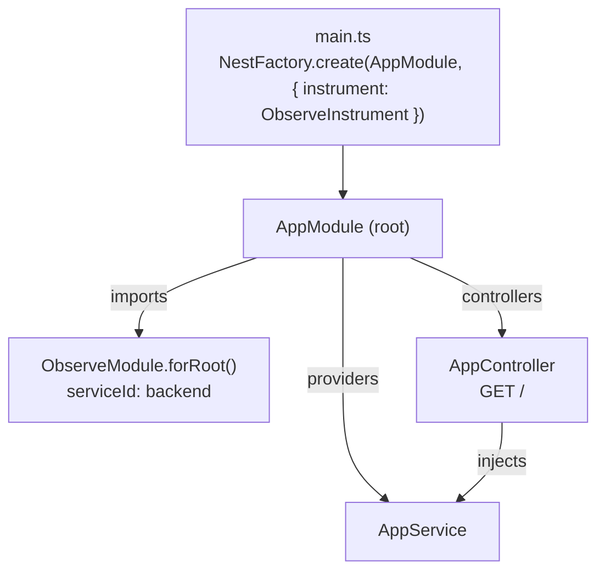
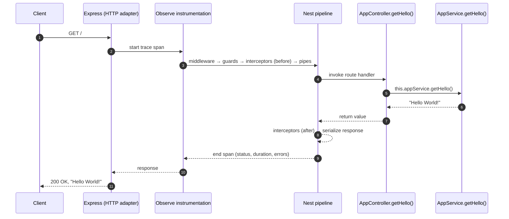

# Architecture

This document describes how the backend is put together and how an HTTP request travels through it. It reflects the code as it is today; update it when you add modules, global guards, interceptors or a database.

## Tech stack

| Concern       | Choice                                                             |
| ------------- | ------------------------------------------------------------------ |
| Runtime       | Node.js, **ESM only** (`"type": "module"`)                         |
| Framework     | NestJS 12 (`@nestjs/core`, `@nestjs/common`)                       |
| HTTP adapter  | Express (`@nestjs/platform-express`)                               |
| Language      | TypeScript (strict, `module: nodenext`, target ES2023)             |
| Observability | NestJS Observe (`@nestjs/observe`) — traces, errors, logs, metrics |
| Tests         | Vitest + `@nestjs/testing`, Supertest for e2e                      |
| Lint / format | oxlint (type-aware) / Prettier                                     |

## Project layout

```
backend/
├── src/
│   ├── main.ts                  # Entry point: creates the Nest app and listens on PORT
│   ├── app.module.ts            # Root module: wires Observe + feature modules
│   ├── app.controller.ts        # Sample controller (GET /)
│   ├── app.service.ts           # Sample service
│   ├── app.controller.spec.ts   # Unit test beside the code
│   └── modules/                 # All feature modules live here
│       └── <feature>/
│           ├── <feature>.module.ts
│           ├── <feature>.controller.ts
│           ├── <feature>.service.ts
│           └── <feature>.*.spec.ts
├── test/
│   └── app.e2e-spec.ts          # End-to-end test against the full AppModule
├── docs/                        # Project documentation (this file)
├── .claude/                     # Claude Code commands, hooks and skills
├── dist/                        # Build output (nest build) — not committed
├── nest-cli.json                # Nest CLI config (sourceRoot: src)
├── tsconfig.json / tsconfig.build.json
├── vitest.config.ts / vitest.config.e2e.ts
└── .env / .env.example          # Runtime configuration
```

### Conventions

- **ESM imports:** relative imports end in `.js` (e.g. `import { AppService } from './app.service.js'`), even though the source is `.ts`. There is no `__dirname`; use `import.meta.dirname`.
- **Feature modules live in `src/modules/`:** each feature gets its own folder `src/modules/<feature>/` with `<feature>.module.ts`, `<feature>.controller.ts`, `<feature>.service.ts`, and is imported into `AppModule` (`import { UsersModule } from './modules/users/users.module.js'`). Only app-wide files (`main.ts`, `app.module.ts`) stay at the root of `src/`. Scaffold with the `/new-module` Claude command, or the Nest CLI: `nest g resource modules/<feature>`.
- **Tests beside code:** unit tests are `*.spec.ts` next to the file they test; e2e tests are `test/*.e2e-spec.ts`.

## Module structure



- **`AppModule`** is the root of the dependency-injection graph. Every feature module must be reachable from its `imports`.
- **`ObserveModule`** is created with `createObserveModule()`, which also returns `ObserveInstrument`. The instrument is passed to `NestFactory.create` so Observe can trace the app from bootstrap onward.
- **`AppController` / `AppService`** are samples generated by the Nest CLI. They show the controller → service pattern and can be removed once real features exist.

## Application startup

1. `main.ts` calls `NestFactory.create(AppModule, { instrument: ObserveInstrument })`.
2. Nest scans `AppModule`, resolves its imports, and instantiates providers and controllers through dependency injection (`AppService` is injected into `AppController`'s constructor).
3. `ObserveModule.forRoot()` initialises telemetry. It is **enabled only when `NODE_ENV === 'production'`** and reads `OBSERVE_APP_KEY` / `OBSERVE_APP_SECRET` from the environment.
4. Routes are registered on the Express adapter and the app listens on `process.env.PORT` (default `3000`).
5. `main.ts` uses top-level `await bootstrap()`, which ESM allows.

## Request flow

Every HTTP request passes through Nest's request pipeline. The stages below are the standard Nest order; the right column shows what this project currently has in each one.



| #   | Stage                  | Purpose                                                           | In this project today                      |
| --- | ---------------------- | ----------------------------------------------------------------- | ------------------------------------------ |
| 1   | HTTP adapter (Express) | Parses the raw request                                            | Default Express adapter                    |
| 2   | Middleware             | Cross-cutting request work (CORS, request IDs, logging)           | None registered                            |
| 3   | Guards                 | Authentication / authorization — can reject with 401/403          | None registered                            |
| 4   | Interceptors (before)  | Wrap the handler: timing, caching, transforming                   | Observe instrumentation traces the request |
| 5   | Pipes                  | Validate and transform `@Body`, `@Param`, `@Query`                | None registered                            |
| 6   | Route handler          | Controller method selected by `@Controller` + `@Get`/`@Post` path | `AppController.getHello()` on `GET /`      |
| 7   | Service / providers    | Business logic, injected via DI                                   | `AppService.getHello()`                    |
| 8   | Interceptors (after)   | Map or wrap the handler's result                                  | None registered                            |
| 9   | Exception filters      | Turn thrown errors into HTTP responses                            | Nest's built-in global filter              |

### Error handling

If anything in steps 2–8 throws:

- An `HttpException` (e.g. `NotFoundException`, `BadRequestException`) becomes a JSON response with that status code: `{ "statusCode": 404, "message": "...", "error": "Not Found" }`.
- Any other error becomes `500 Internal Server Error`, and the real error is logged rather than returned to the client.
- In production, Observe records the error with its trace and logs so it can be investigated in the Observe dashboard.

### Where to add things

| Need                           | Put it in                                                                          |
| ------------------------------ | ---------------------------------------------------------------------------------- |
| New endpoints                  | A feature module in `src/modules/<feature>/`, imported into `AppModule`            |
| Request validation             | A Standard Schema (e.g. Zod) with `@Body({ schema })` / `@Param('id', { schema })` |
| Authentication                 | A global guard via `@nestjs/authentication` (`@Public()` to opt routes out)        |
| Configuration / env validation | `@nestjs/config`                                                                   |
| Database                       | `@nestjs/typeorm` or `@nestjs/drizzle` in its own module                           |
| Rate limiting                  | `@nestjs/throttler`                                                                |

## Configuration

| Variable             | Used by                                                  | Default               |
| -------------------- | -------------------------------------------------------- | --------------------- |
| `PORT`               | `main.ts`                                                | `3000`                |
| `NODE_ENV`           | `ObserveModule` — telemetry is on only when `production` | unset (telemetry off) |
| `OBSERVE_APP_KEY`    | `ObserveModule`                                          | placeholder           |
| `OBSERVE_APP_SECRET` | `ObserveModule`                                          | placeholder           |

`npm start`, `start:dev` and `start:debug` load `.env` with `--env-file .env`. `npm run start:prod` (`node dist/main`) does **not**, so in production the variables must come from the real environment.

## Build and run

| Command                           | What it does                                                                                      |
| --------------------------------- | ------------------------------------------------------------------------------------------------- |
| `npm run start:dev`               | Watch mode, loads `.env`                                                                          |
| `npm run build`                   | `nest build` → compiles `src/` to `dist/` using `tsconfig.build.json` (specs excluded)            |
| `npm run start:prod`              | Runs the compiled `dist/main.js`                                                                  |
| `npm test`                        | Unit tests (`**/*.spec.ts`)                                                                       |
| `npm run test:e2e`                | E2E tests (`**/*.e2e-spec.ts`) — boots the full `AppModule` and calls it over HTTP with Supertest |
| `npm run lint` / `npm run format` | oxlint / Prettier                                                                                 |

## Testing layers

- **Unit tests** build a small testing module with `Test.createTestingModule({ controllers, providers })` and call methods directly. Dependencies are replaced with `vi.fn()` mocks.
- **E2E tests** import the real `AppModule`, call `createNestApplication()` and `init()`, and send real HTTP requests through the full pipeline described above.
