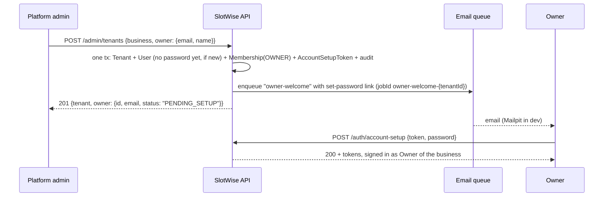

# F01 — Tenancy & Business Onboarding

**Phase:** 1 · **Modules:** 1.10 Authorization (isolation) · **Depends on:** F00, F02

**Status:** ✅ Completed — **v1** (2026-11-22) · see [Implementation summary](#implementation-summary-v1)

## Goal

Many businesses share one deployment and one database, and **Clinic A can never see Clinic B's data** — not through a bug in a `where` clause, not through a guessed UUID.

## Model: shared schema, `tenant_id` everywhere

Every business-owned table has `tenant_id uuid not null` with a foreign key to `tenant`, and every composite index starts with `tenant_id`.

```prisma
model Tenant {
  id              String       @id @default(uuid(7)) @db.Uuid
  slug            String       @unique            // public booking URL: /b/glow-salon
  name            String
  phone           String?                          // E.164, +91…
  city            String?
  status          TenantStatus @default(ACTIVE)   // ACTIVE | SUSPENDED
  createdAt       DateTime     @default(now()) @map("created_at") @db.Timestamptz(3)
  @@map("tenant")
}
```

## Two layers of isolation

1. **Application layer.** Repositories take `tenantId` as a required first argument; no repository method exists that reads a tenant table without it. Lookups by id are always `where: { id, tenantId }`, so a foreign id returns 404, not 403 (don't leak existence).
2. **Database layer (defense in depth): PostgreSQL Row-Level Security.**
   - Enable RLS on every tenant table with policy `tenant_id = current_setting('app.tenant_id')::uuid`.
   - The app connects as a non-owner role (`slotwise_app`) so policies apply; migrations run as the owner.
   - Tenant-scoped work runs inside `prisma.$transaction(async (tx) => { await tx.$executeRaw\`SELECT set_config('app.tenant_id', ${tenantId}, true)\`; ... })`— a`TenantPrisma` helper wraps this.
   - Platform-admin jobs use a separate role with `BYPASSRLS`, only in admin/job code paths.

## Tenant resolution

| Caller                   | Where tenant comes from                                                                                                                       |
| ------------------------ | --------------------------------------------------------------------------------------------------------------------------------------------- |
| Staff-side user          | The active membership in their session (`X-Tenant-Id` header selects one when a user belongs to several businesses; must match a membership). |
| Customer on public pages | Path slug: `GET /public/:tenantSlug/...`                                                                                                      |
| Signed-in customer       | The booking's `tenant_id`; customer endpoints are scoped by `customer_account_id`.                                                            |
| Webhooks / jobs          | Payload carries `tenantId`; job sets RLS context before touching data.                                                                        |

A `TenantGuard` resolves the tenant, rejects `SUSPENDED` tenants (403 `TENANT_SUSPENDED`), and puts `tenantId` into `RequestContext`.

## Onboarding: the platform admin creates the business and its Owner

There is **no self-signup** for businesses. Only a platform admin (seeded in F00) creates a tenant, and does it together with the Owner in one step.



```json
// POST /admin/tenants
{
  "name": "Glow Salon",
  "slug": "glow-salon",
  "phone": "+919876543210",
  "city": "Ahmedabad",
  "owner": { "email": "owner@glow.example", "name": "Asha Patel" }
}
```

Rules:

- Whole request is one transaction; slug taken → 409 `SLUG_TAKEN`; the email is only queued after commit (outbox / after-commit enqueue).
- The admin **never sets or sees the Owner's password**. The Owner sets it through a single-use link (72 h). See `AccountSetupToken` in F02.
- If the owner email already belongs to a staff-side `User` (e.g. they own another business), no new user or token is created; the membership is added and an "you've been made Owner of …" email is sent instead.
- The owner email cannot belong to a platform admin (422) — keep platform and tenant identities separate.
- Audited as `tenant.created` and `membership.created` with `actorType = PLATFORM_ADMIN`.

## API

| Method | Path                                    | Who            | Notes                                                                                                        |
| ------ | --------------------------------------- | -------------- | ------------------------------------------------------------------------------------------------------------ |
| POST   | `/admin/tenants`                        | Platform admin | Creates tenant + Owner (above).                                                                              |
| GET    | `/admin/tenants`, `/admin/tenants/:id`  | Platform admin | List / detail (more filters in F19).                                                                         |
| POST   | `/admin/tenants/:id/owner/resend-setup` | Platform admin | New setup link if the Owner hasn't set a password yet; old token invalidated. 409 if already set up.         |
| PUT    | `/admin/tenants/:id/owner`              | Platform admin | Replace a **pending** Owner (wrong email typed). Once the Owner is active, use ownership transfer (F03).     |
| GET    | `/tenants/current`                      | Any member     | Business profile.                                                                                            |
| PATCH  | `/tenants/current`                      | Owner, Manager | Name, phone, address. (No timezone, currency or locale: SlotWise is India-only and INR-only; times are UTC.) |
| GET    | `/public/:slug`                         | Anyone         | Public profile: name, services, staff display names.                                                         |

## Business rules

- Slug: lowercase, `^[a-z0-9-]{3,40}$`, reserved words blocked (`admin`, `api`, `www`).
- No timezone, currency or locale fields: every business is in India and charges INR; all times are UTC and the frontend shows them in local time (see [overview](../product/overview.md#india-only-time-and-money)).

## Acceptance criteria / tests

- E2E onboarding: seeded admin signs in → `POST /admin/tenants` → setup email appears (Mailpit / mail transport `log` in tests) → Owner sets password via the link → Owner `GET /tenants/current` returns the new business.
- Owner, Manager or any non-admin calling `POST /admin/tenants` → 403.
- Setup link used twice → 410; after expiry → 410; `resend-setup` issues a working new link and the old one stops working.
- Duplicate slug → 409 and nothing is created (no orphan user or membership).

- E2E: user of tenant A requests `GET /bookings/:id` with tenant B's booking id → **404**.
- E2E: raw query through the app role without `app.tenant_id` set returns **zero rows** (RLS proves itself even if the app forgets).
- Unit: every repository method signature requires `tenantId` (enforced by a lint rule or review checklist).
- Suspended tenant: public page returns 404, staff API returns 403.

## Implementation summary (v1)

**Completed:** 2026-11-22 · **Branch:** `main` (not yet committed at time of writing) · built right after F02.

### What was built

| Item                                                                                      | Status | Where                                                          | Notes                                                                                                                  |
| ----------------------------------------------------------------------------------------- | ------ | -------------------------------------------------------------- | ---------------------------------------------------------------------------------------------------------------------- |
| `Tenant` model (`slug`, `name`, `phone`, `city`, `status`)                                | ✅     | `prisma/schema.prisma`, migration `20261122081238_add_tenancy` | Plus `address` (PATCH edits it) and `updatedAt`.                                                                       |
| `tenant_id` on every tenant table, indexes start with it                                  | ✅     | `membership`, `audit_log`                                      | The only tenant tables so far.                                                                                         |
| Application layer: repositories take `tenantId` first; lookups `where: { id, tenantId }`  | ✅     | `tenancy/repositories/memberships.repository.ts`               | Rule written into AGENTS.md / architecture as a review checklist.                                                      |
| RLS policy `tenant_id = current_setting('app.tenant_id')`                                 | ✅     | migration                                                      | Via `app_current_tenant_id()` (`NULLIF(…, '')::uuid`, so an unset/reset tenant matches nothing).                       |
| App connects as non-owner `slotwise_app`; migrations as owner                             | ✅     | `prisma.service.ts` (`-c role=…`), migration                   | Role switch at connect: `DATABASE_URL` stays one URL.                                                                  |
| `TenantPrisma` helper (`set_config(…, true)` in a transaction)                            | ✅     | `shared/database/tenant-prisma.service.ts`                     | `run()`, `runInCurrent()`, `runAsUser()`.                                                                              |
| Platform-admin role with `BYPASSRLS`, admin/job paths only                                | ✅     | `AdminPrismaService`, role `slotwise_admin`                    | Used by `TenantOnboardingService` only.                                                                                |
| `TenantGuard`: resolve tenant, reject SUSPENDED (403), put `tenantId` in `RequestContext` | ✅     | `tenancy/tenant.guard.ts`, `@TenantScoped(...roles)`           | `X-Tenant-Id` must match an active membership.                                                                         |
| Tenant resolution — staff (membership / `X-Tenant-Id`)                                    | ✅     | `TenantGuard`                                                  |                                                                                                                        |
| Tenant resolution — public slug                                                           | ✅     | `GET /public/:slug`                                            |                                                                                                                        |
| Tenant resolution — signed-in customer, webhooks / jobs                                   | ⏭️     | —                                                              | Bookings (F07), webhooks (F11), jobs (F15); `TenantPrismaService.run(tenantId)` is the tool.                           |
| `POST /admin/tenants` (one tx, Owner, setup link, audit, email after commit)              | ✅     | `admin-tenants.controller.ts`, `tenant-onboarding.service.ts`  | `jobId owner-welcome-{tenantId}`.                                                                                      |
| Existing staff user as Owner → membership only + "made Owner" email                       | ✅     | `addOwner()`                                                   | A still-pending user gets a fresh setup link instead.                                                                  |
| Platform-admin email as Owner → 422                                                       | ✅     | `OWNER_IS_PLATFORM_ADMIN`                                      | Disabled user → 422 `OWNER_DISABLED`.                                                                                  |
| Audit `tenant.created`, `membership.created` with `actorType = PLATFORM_ADMIN`            | ✅     | `audit/audit.service.ts`                                       |                                                                                                                        |
| `GET /admin/tenants`, `GET /admin/tenants/:id`                                            | ✅     |                                                                | Keyset pagination on the UUIDv7 id, `?status=`.                                                                        |
| `POST /admin/tenants/:id/owner/resend-setup`                                              | ✅     |                                                                | 202; old link invalidated; 409 `OWNER_ALREADY_ACTIVE`.                                                                 |
| `PUT /admin/tenants/:id/owner` (replace a pending Owner)                                  | ✅     |                                                                | Old membership REMOVED, old links revoked, old user DISABLED if it has no other business; audited.                     |
| `GET /tenants/current` (any member)                                                       | ✅     | `tenants.controller.ts`                                        |                                                                                                                        |
| `PATCH /tenants/current` (Owner, Manager)                                                 | ✅     |                                                                | Name, phone, city, address; no timezone/currency/locale (strict schema); audited `tenant.updated` with changed fields. |
| `GET /public/:slug`                                                                       | ✅     | `public-tenants.controller.ts`                                 | Name + contact; services and staff names come with F05 / F04.                                                          |
| Slug rules (`^[a-z0-9-]{3,40}$`, reserved words)                                          | ✅     | `tenancy.schemas.ts`                                           | Reserved: admin, api, www, app, auth, public, static, assets, docs, help, support, slotwise.                           |

### Decisions that differ from the spec

- **F02 was built first** (the spec depends on it and it wasn't started).
- **`Membership` (F04's model) and `AuditLog` (F09's table + `AuditService`) were created here**, because onboarding writes an OWNER membership and audit rows. F04 adds `staffId` / `Staff`; F09 adds its API, the update-rejecting trigger and retention. The single-Owner partial unique index (F04) is in this migration.
- **The app reaches `slotwise_app` by `SET ROLE` at connect** (`-c role=slotwise_app`) instead of a separate login: one `DATABASE_URL`, and the migrating user is granted both roles. A dedicated login role in production is still possible (make it a member of both).
- **`membership` has a second SELECT policy `own_memberships`** (`user_id = app.user_id`), so `TenantGuard` can list a user's businesses before a tenant is chosen, without the admin role.
- **The `tenant` table has no RLS**: it has no `tenant_id` and holds the public profile; code always looks it up by the request's tenant id or a slug.
- **Roles on tenant routes are checked by `TenantGuard`** (`@TenantScoped('OWNER','MANAGER')`) until F03 brings `@nestjs/authorization`.
- **Emails are enqueued right after commit**, not through an outbox (F13): if Redis is down at that moment the email is lost and the admin uses resend-setup.
- **Unknown fields in `POST /admin/tenants` are ignored** (e.g. `timezone`), while `PATCH /tenants/current` is strict and rejects them.

### New scripts, env vars and dependencies

- Env: `DATABASE_APP_ROLE` (`slotwise_app`), `DATABASE_ADMIN_ROLE` (`slotwise_admin`). In `.env.example` and `docs/architecture.md`.
- Migration `20261122081238_add_tenancy`: tables, single-Owner index, roles, grants + default privileges, `app_current_tenant_id()` / `app_current_user_id()`, RLS policies, append-only audit grants.
- Mails: `owner-welcome`, `owner-added`. Error codes: `SLUG_TAKEN`, `TENANT_SUSPENDED`, `NOT_A_MEMBER`, `TENANT_REQUIRED`, `OWNER_IS_PLATFORM_ADMIN`, `OWNER_DISABLED`, `OWNER_ALREADY_ACTIVE`.
- No new dependencies.

### Tests

- Unit: `tenant.guard.spec.ts` (resolution, header, suspended, roles, customers), `tenancy.schemas.spec.ts` (slug, phone, strict update), `audit.service.spec.ts` (actor mapping).
- E2E: `test/tenancy.e2e-spec.ts` (24 cases). Test helpers now clean up with `resetDatabase(admin)` (TRUNCATE as the admin role).
- Final counts: **unit 134 passed**, **e2e 79 passed** (9 files), twice in a row. Format, lint, typecheck, build clean; CI's migrate-deploy + drift check + seed replayed on a fresh database.

### Acceptance criteria

| Criterion                                                                                                           | Status | How verified                                                                                                                                                      |
| ------------------------------------------------------------------------------------------------------------------- | ------ | ----------------------------------------------------------------------------------------------------------------------------------------------------------------- |
| E2E onboarding: admin signs in → `POST /admin/tenants` → setup email → Owner sets password → `GET /tenants/current` | ✅     | e2e "admin creates the business + Owner…" (in-memory mail transport).                                                                                             |
| Owner, Manager or any non-admin calling `POST /admin/tenants` → 403                                                 | ✅     | e2e "rejects Owners, customers and anonymous callers" (anonymous → 401).                                                                                          |
| Setup link used twice → 410; after expiry → 410; resend issues a working link and the old one stops working         | ✅     | e2e "setup links" cases.                                                                                                                                          |
| Duplicate slug → 409 and nothing created                                                                            | ✅     | e2e: user, membership and tenant counts unchanged, no user for the new email, no email sent.                                                                      |
| User of tenant A requests `GET /bookings/:id` with B's id → 404                                                     | ⏳     | Bookings arrive in F07. Proven at the data layer now: inside tenant A, `findUnique` on B's membership id returns null, and `X-Tenant-Id: B` → 403 `NOT_A_MEMBER`. |
| Raw query through the app role without `app.tenant_id` returns zero rows                                            | ✅     | e2e: 2 memberships exist (admin count), raw `SELECT count(*)` as the app role → 0. Also: cross-tenant insert rejected by the policy.                              |
| Unit: every repository method requires `tenantId`                                                                   | ⏳     | Review checklist in AGENTS.md (the spec allows a checklist); `MembershipsRepository` follows it. A lint rule could come once more tenant repositories exist.      |
| Suspended tenant: public 404, staff 403                                                                             | ✅     | e2e "suspended business…".                                                                                                                                        |

### Follow-ups for later features

- **F03:** replace `@TenantScoped(...roles)` role checks with `@nestjs/authorization`; ownership transfer (`PUT /admin/tenants/:id/owner` stops at an active Owner).
- **F04:** `Staff` model and `staffId` on `Membership`; reactivating a REMOVED membership (the `(tenant_id, user_id)` unique constraint); `GET /me` memberships; public profile lists staff names. Cache memberships ≤ 60 s if `TenantGuard`'s per-request lookup shows up in traces.
- **F05:** services on the public profile.
- **F09:** audit API, update-rejecting trigger, retention.
- **F13:** send onboarding emails through the outbox instead of after-commit enqueue.
- **F19:** suspend / reactivate endpoints (status exists; tests set it directly).
- **From F02, still open:** validate `tenantSlug` on `POST /auth/customer/magic-link` (unknown/suspended business) and put the business name in the magic-link email. Not done here to keep `AuthModule` independent of `TenancyModule` (it would need a small slug-lookup provider in `shared/`).
