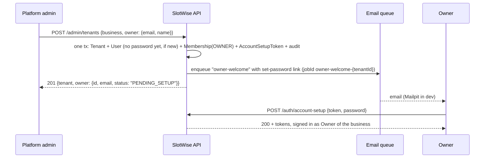

# F01 — Tenancy & Business Onboarding

**Phase:** 1 · **Modules:** 1.10 Authorization (isolation) · **Depends on:** F00, F02

## Goal

Many businesses share one deployment and one database, and **Clinic A can never see Clinic B's data** — not through a bug in a `where` clause, not through a guessed UUID.

## Model: shared schema, `tenant_id` everywhere

Every business-owned table has `tenant_id uuid not null` with a foreign key to `tenant`, and every composite index starts with `tenant_id`.

```prisma
model Tenant {
  id              String       @id @default(uuid(7)) @db.Uuid
  slug            String       @unique            // public booking URL: /b/glow-salon
  name            String
  phone           String?                          // E.164, +91…
  city            String?
  status          TenantStatus @default(ACTIVE)   // ACTIVE | SUSPENDED
  createdAt       DateTime     @default(now()) @map("created_at") @db.Timestamptz(3)
  @@map("tenant")
}
```

## Two layers of isolation

1. **Application layer.** Repositories take `tenantId` as a required first argument; no repository method exists that reads a tenant table without it. Lookups by id are always `where: { id, tenantId }`, so a foreign id returns 404, not 403 (don't leak existence).
2. **Database layer (defense in depth): PostgreSQL Row-Level Security.**
   - Enable RLS on every tenant table with policy `tenant_id = current_setting('app.tenant_id')::uuid`.
   - The app connects as a non-owner role (`slotwise_app`) so policies apply; migrations run as the owner.
   - Tenant-scoped work runs inside `prisma.$transaction(async (tx) => { await tx.$executeRaw\`SELECT set_config('app.tenant_id', ${tenantId}, true)\`; ... })`— a`TenantPrisma` helper wraps this.
   - Platform-admin jobs use a separate role with `BYPASSRLS`, only in admin/job code paths.

## Tenant resolution

| Caller                   | Where tenant comes from                                                                                                                       |
| ------------------------ | --------------------------------------------------------------------------------------------------------------------------------------------- |
| Staff-side user          | The active membership in their session (`X-Tenant-Id` header selects one when a user belongs to several businesses; must match a membership). |
| Customer on public pages | Path slug: `GET /public/:tenantSlug/...`                                                                                                      |
| Signed-in customer       | The booking's `tenant_id`; customer endpoints are scoped by `customer_account_id`.                                                            |
| Webhooks / jobs          | Payload carries `tenantId`; job sets RLS context before touching data.                                                                        |

A `TenantGuard` resolves the tenant, rejects `SUSPENDED` tenants (403 `TENANT_SUSPENDED`), and puts `tenantId` into `RequestContext`.

## Onboarding: the platform admin creates the business and its Owner

There is **no self-signup** for businesses. Only a platform admin (seeded in F00) creates a tenant, and does it together with the Owner in one step.



```json
// POST /admin/tenants
{
  "name": "Glow Salon",
  "slug": "glow-salon",
  "phone": "+919876543210",
  "city": "Ahmedabad",
  "owner": { "email": "owner@glow.example", "name": "Asha Patel" }
}
```

Rules:

- Whole request is one transaction; slug taken → 409 `SLUG_TAKEN`; the email is only queued after commit (outbox / after-commit enqueue).
- The admin **never sets or sees the Owner's password**. The Owner sets it through a single-use link (72 h). See `AccountSetupToken` in F02.
- If the owner email already belongs to a staff-side `User` (e.g. they own another business), no new user or token is created; the membership is added and an "you've been made Owner of …" email is sent instead.
- The owner email cannot belong to a platform admin (422) — keep platform and tenant identities separate.
- Audited as `tenant.created` and `membership.created` with `actorType = PLATFORM_ADMIN`.

## API

| Method | Path                                    | Who            | Notes                                                                                                        |
| ------ | --------------------------------------- | -------------- | ------------------------------------------------------------------------------------------------------------ |
| POST   | `/admin/tenants`                        | Platform admin | Creates tenant + Owner (above).                                                                              |
| GET    | `/admin/tenants`, `/admin/tenants/:id`  | Platform admin | List / detail (more filters in F19).                                                                         |
| POST   | `/admin/tenants/:id/owner/resend-setup` | Platform admin | New setup link if the Owner hasn't set a password yet; old token invalidated. 409 if already set up.         |
| PUT    | `/admin/tenants/:id/owner`              | Platform admin | Replace a **pending** Owner (wrong email typed). Once the Owner is active, use ownership transfer (F03).     |
| GET    | `/tenants/current`                      | Any member     | Business profile.                                                                                            |
| PATCH  | `/tenants/current`                      | Owner, Manager | Name, phone, address. (No timezone, currency or locale: SlotWise is India-only and INR-only; times are UTC.) |
| GET    | `/public/:slug`                         | Anyone         | Public profile: name, services, staff display names.                                                         |

## Business rules

- Slug: lowercase, `^[a-z0-9-]{3,40}$`, reserved words blocked (`admin`, `api`, `www`).
- No timezone, currency or locale fields: every business is in India and charges INR; all times are UTC and the frontend shows them in local time (see [overview](../product/overview.md#india-only-time-and-money)).

## Acceptance criteria / tests

- E2E onboarding: seeded admin signs in → `POST /admin/tenants` → setup email appears (Mailpit / mail transport `log` in tests) → Owner sets password via the link → Owner `GET /tenants/current` returns the new business.
- Owner, Manager or any non-admin calling `POST /admin/tenants` → 403.
- Setup link used twice → 410; after expiry → 410; `resend-setup` issues a working new link and the old one stops working.
- Duplicate slug → 409 and nothing is created (no orphan user or membership).

- E2E: user of tenant A requests `GET /bookings/:id` with tenant B's booking id → **404**.
- E2E: raw query through the app role without `app.tenant_id` set returns **zero rows** (RLS proves itself even if the app forgets).
- Unit: every repository method signature requires `tenantId` (enforced by a lint rule or review checklist).
- Suspended tenant: public page returns 404, staff API returns 403.
