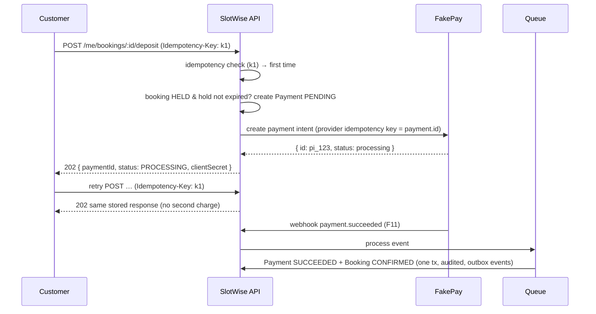

# F10 — Deposits & Payments

**Phase:** 3 · **Modules:** 2.5 Idempotency, 1.12 Money · **Depends on:** F07, F11 (provider), F12 (resilience)

## Goal

A customer pays a deposit to turn a `HELD` booking into `CONFIRMED`. A double-click, a browser retry or a flaky network **charges once**.

## Data model

```prisma
enum PaymentStatus { PENDING PROCESSING SUCCEEDED FAILED REFUNDED PARTIALLY_REFUNDED }

model Payment {
  id                 String        @id @default(uuid(7)) @db.Uuid
  tenantId           String        @map("tenant_id") @db.Uuid
  bookingId          String        @map("booking_id") @db.Uuid
  amountMinor        Int           @map("amount_minor")       // paise, INR
  status             PaymentStatus
  provider           String                                   // "fakepay"
  providerPaymentId  String?       @unique @map("provider_payment_id")
  idempotencyKey     String        @map("idempotency_key")    // key we send to the provider
  failureCode        String?       @map("failure_code")
  refundedMinor      Int           @default(0) @map("refunded_minor")
  createdAt          DateTime      @default(now()) @map("created_at") @db.Timestamptz(3)
  @@unique([tenantId, idempotencyKey])
  @@map("payment")
}
```

Partial unique index: one non-failed deposit per booking — `CREATE UNIQUE INDEX ON payment (booking_id) WHERE status IN ('PENDING','PROCESSING','SUCCEEDED')`.

## Flow



## Idempotency (2.5)

Use `@nestjs/idempotency` on `POST /me/bookings/:id/deposit`, `POST /public/:slug/bookings` and refund endpoints:

- Client sends `Idempotency-Key` (UUID). Missing → 400 on these routes.
- Key is scoped to `(actor, route)`; stored in Redis/Postgres with request fingerprint (hash of body) and the response, TTL 24 h.
- Same key + same body while the first request is **still running** → 409 `REQUEST_IN_PROGRESS` (lock).
- Same key + same body after completion → replay the stored status and body.
- Same key + **different** body → 422 `IDEMPOTENCY_KEY_REUSED`.
- **Second layer:** we pass our `payment.id` as the provider's idempotency key, so even if our layer fails, the provider dedupes. **Third layer:** the partial unique index above.

## Rules

- Can only pay a `HELD` booking whose hold hasn't expired → else 409 `HOLD_EXPIRED` (customer must re-book).
- Starting payment extends the hold by 5 min once, so slow 3-DS flows don't lose the slot.
- Amount comes from the booking (`depositMinor`), **never** from the request body.
- Booking is confirmed **only** by the verified webhook (or a reconciliation job asking the provider), never by the client saying "it worked".
- If `payment.succeeded` arrives for a booking that already expired/was cancelled → auto-refund and notify (race between hold expiry and payment).
- Refunds: `POST /bookings/:id/refund {amountMinor?}` (Owner/Manager), partial allowed, `refundedMinor ≤ amountMinor`, idempotent, audited.

## Acceptance criteria

- 10 parallel deposit requests with the same key → exactly one provider call, all responses identical.
- Same key, different booking id → 422.
- Webhook for an expired hold triggers a refund and a `booking.payment_orphaned` alert.
- All amounts in tests are integer paise; `₹1,23,456.00` formatting (Indian grouping) is checked.
