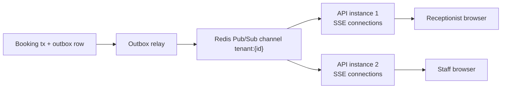

# F17 — Real-Time Calendar

**Phase:** 4 · **Modules:** 2.14 Real-time · **Depends on:** F03, F07, F13 (events)

## Goal

The receptionist's calendar updates live when a customer books online — no refresh — and every user only receives events they're allowed to see.

## Transport: Server-Sent Events (recommended)

The traffic is one-way (server → browser), so SSE is enough: plain HTTP, auto-reconnect, works through proxies. Nest supports `@Sse()` and streaming responses. (Alternative for learning: `@nestjs/websockets` gateway with rooms — note the trade-offs in the PR.)

`GET /realtime/stream` (authenticated; token via cookie or short-lived `?ticket=` obtained from `POST /realtime/ticket`, because `EventSource` can't send headers).

## Fan-out across instances

- Each instance subscribes to `rt:tenant:{tenantId}` for tenants with open connections.
- Events published **after commit** only (via outbox), so clients never see a booking that rolled back.

## Events & filtering

| Event                  | Payload                                               | Who receives                                                  |
| ---------------------- | ----------------------------------------------------- | ------------------------------------------------------------- |
| `booking.upserted`     | id, staffId, start/end, status, customer display name | Owner/Manager/Receptionist; Staff only if `staffId` is theirs |
| `booking.removed`      | id, staffId                                           | same                                                          |
| `notification.created` | in-app notification (F14)                             | the target user                                               |
| `availability.changed` | staffId, date                                         | (optional) public page clients                                |

Filtering uses the same F03 policy functions as the REST API — no separate permission logic. Payload contains no phone/email; the client fetches details through REST if allowed.

## Reliability

- Each event has a monotonic `id`; SSE `Last-Event-ID` on reconnect → server replays missed events from a short Redis Stream (`XADD` with `MAXLEN ~ 1000` per tenant). If too old, send `resync` and the client refetches the calendar.
- Heartbeat comment every 25 s to keep proxies from closing the connection.
- Close streams on logout / membership removal; limit 5 concurrent streams per user.

## Acceptance criteria

- E2E: open stream as receptionist, create a public booking → event arrives < 1 s.
- Staff A's stream never receives Staff B's booking events.
- Tenant B's stream never receives tenant A's events.
- With two app instances, an event produced on instance 1 reaches a client on instance 2.
- Disconnect, create 3 bookings, reconnect with `Last-Event-ID` → 3 events replayed.
