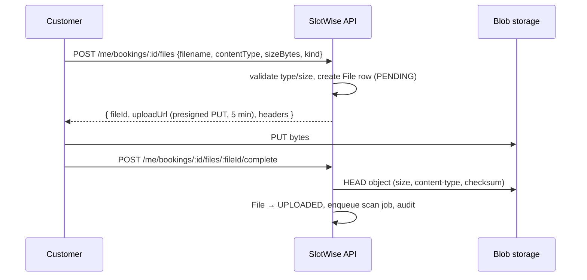

# F18 — Files (Intake Uploads) & Revenue Reports

**Phase:** 5 · **Modules:** 2.12 Files, 2.8 Jobs · **Depends on:** F07, F15, F09

## Goal

Customers upload intake forms / ID documents **straight to blob storage** (the API never streams the bytes), and businesses get a monthly revenue report generated in the background.

## Storage

`@nestjs/storage` with an S3-compatible driver: **MinIO** in `docker-compose.yml` for dev/test, S3 in production. Wrapped in `src/shared/storage/` (`SharedStorageModule`) with a health indicator. Private bucket; no public objects.

## Intake uploads — presigned flow



```prisma
model File {
  id          String   @id @default(uuid(7)) @db.Uuid
  tenantId    String   @map("tenant_id") @db.Uuid
  bookingId   String?  @map("booking_id") @db.Uuid
  ownerType   String   @map("owner_type")          // CUSTOMER | USER | SYSTEM
  ownerId     String   @map("owner_id") @db.Uuid
  kind        String                               // INTAKE_FORM | ID_DOCUMENT | REPORT
  storageKey  String   @unique @map("storage_key") // tenants/{tenantId}/bookings/{bookingId}/{fileId}
  contentType String   @map("content_type")
  sizeBytes   Int      @map("size_bytes")
  status      String                               // PENDING | UPLOADED | REJECTED | DELETED
  createdAt   DateTime @default(now()) @map("created_at") @db.Timestamptz(3)
  @@index([tenantId, bookingId])
  @@map("file")
}
```

Rules:

- Allowed: PDF, JPEG, PNG, HEIC; max 10 MB; content type enforced in the presigned policy and re-checked on complete (magic bytes via a range GET).
- Storage key always prefixed by `tenants/{tenantId}/` — never derived from the client filename.
- Download: `GET /bookings/:id/files/:fileId` → 302 to a presigned GET valid 60 s, only for roles allowed to see the customer's PII (F03); every download audited.
- `PENDING` files older than 1 h are deleted by a cleanup job (orphaned uploads).
- (Stretch) virus scan job with ClamAV container before `UPLOADED`.

## Monthly revenue report

- Job `revenue-${tenantId}-${yyyy-mm}` (F15) runs on the 1st at 03:00 IST, or on demand: `POST /reports/revenue { from, to }` (UTC range the frontend computed from the local month) → `202 { reportId }`.
- The scheduled monthly job uses the IST month as a UTC range: November 2026 = `[2026-10-31T18:30:00Z, 2026-11-30T18:30:00Z)`. Timestamps in the CSV are written as UTC ISO plus an IST column for readability, since spreadsheets don't convert.
- Content (CSV, optionally PDF): per day and per staff/service — bookings confirmed, completed, cancelled, no-shows, deposits collected, refunds, net, all in paise summed as integers, formatted as ₹ in `en-IN`.
- Generated by **streaming** the query (cursor) into a CSV stream piped to storage — constant memory even for large tenants.
- `Report` row (`PENDING → READY | FAILED`), notification + email to Owner/Managers with a link; `GET /reports/:id/download` → presigned URL.

## Acceptance criteria

- Upload a 12 MB file → rejected by the presigned policy; a `.exe` renamed `.pdf` rejected on complete.
- Staff without access to the booking cannot get a download URL (404).
- Revenue report totals equal a hand-calculated fixture, including bookings at 23:30 IST on the last day and 00:30 IST on the 1st, and a refund.
- Report generation for 100k bookings stays under a fixed memory budget (stream test).
