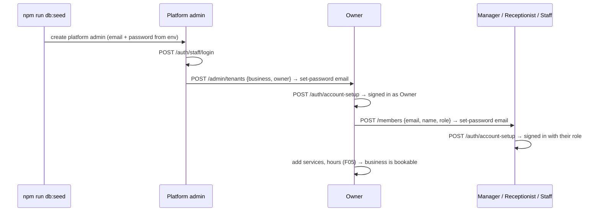
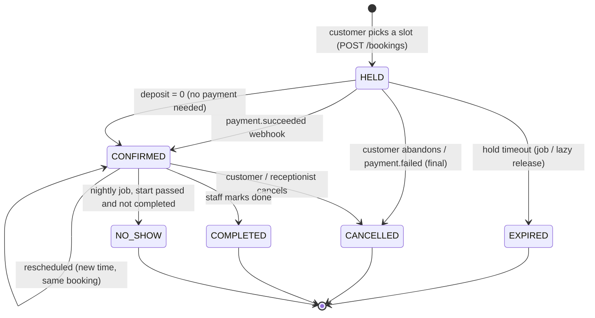

# SlotWise — Product Overview

SlotWise is a **multi-tenant booking SaaS**. A business (salon, clinic, tutor) publishes its services, staff and working hours; customers book online and pay a deposit to confirm.

**SlotWise is India-only.** There is **no timezone setting anywhere** (no tenant, staff or customer timezone, no `tz` parameter) and **one currency, INR**. **Everything time-related is stored in UTC in the database and exchanged in UTC over the API; the frontend converts to and from the user's local time.** The backend does no timezone conversion for data. See [Time and money](#india-only-time-and-money).

This repository is the backend for the Node.js 201 PoC. It is built like a production system: every feature maps to one or more learning modules (1.x / 2.x) and is specified in [`docs/features/`](../features/). The delivery order is in [`docs/roadmap.md`](../roadmap.md).

## Glossary

| Term                  | Meaning                                                                                                                                                 |
| --------------------- | ------------------------------------------------------------------------------------------------------------------------------------------------------- |
| **Tenant / Business** | One customer of SlotWise (e.g. "Glow Salon"). Every business-owned row carries `tenant_id`.                                                             |
| **Platform**          | SlotWise itself, operated by platform admins.                                                                                                           |
| **Staff member**      | A person whose calendar can be booked. May or may not have a login.                                                                                     |
| **Service**           | Something bookable: name, duration, buffer, price, deposit.                                                                                             |
| **Working hours**     | Weekly recurring windows a staff member works, stored as UTC weekday + UTC start time + duration. The frontend converts "Mon 09:00–17:00" local to UTC. |
| **Time off**          | An exact interval a staff member is unavailable, stored as UTC timestamps.                                                                              |
| **Holiday**           | A business-wide closure stored as a UTC range (`starts_at`, `ends_at`). The frontend sends the UTC range for the local day(s).                          |
| **Slot**              | A start instant at which a service can be booked with a given staff member. Computed, never stored.                                                     |
| **Hold**              | A booking in `HELD` status that reserves a slot for a few minutes while the customer pays.                                                              |
| **Deposit**           | Amount in **paise** (INR minor units) charged to confirm a booking.                                                                                     |
| **Paise**             | Integer money: `250000` = ₹2,500.00. Never floats.                                                                                                      |

## Roles

| Role               | Scope              | Can do                                                                                                                                                                                           |
| ------------------ | ------------------ | ------------------------------------------------------------------------------------------------------------------------------------------------------------------------------------------------ |
| **Platform admin** | Whole platform     | The only seeded user. Creates businesses and each business's Owner. Sees all tenants, failed jobs, webhook logs. **Never sees customer PII by default** (masked; break-glass access is audited). |
| **Owner**          | One business       | Everything in the business, including billing settings, deposit policy and staff. Adds Managers, Receptionists and Staff. Can transfer ownership.                                                |
| **Manager**        | One business       | Services, staff, schedules and all bookings. No billing, no ownership transfer.                                                                                                                  |
| **Receptionist**   | One business       | Creates, moves and cancels bookings for any staff member. Sees customer contact details.                                                                                                         |
| **Staff**          | One business       | Sees and manages only **their own** calendar and bookings.                                                                                                                                       |
| **Customer**       | Their own bookings | Books, pays, reschedules and cancels their own bookings. Signs in with a magic link, a password, Google or Microsoft.                                                                            |

Staff-side users sign in with **email + password**. Customers sign in with a **magic link, email + password, Google or Microsoft** (personal accounts), whichever they prefer; they can set a password and link or unlink Google/Microsoft later from their account ([F02 v2](../features/F02-authentication.md#v2--social-sign-in-for-customers-google-microsoft)). Social sign-in is **customers only**. Both use `@nestjs/authentication`.

## Learning-module coverage

| Module    | Topic                                                                                                         | Feature spec                                                                                                                                                                 |
| --------- | ------------------------------------------------------------------------------------------------------------- | ---------------------------------------------------------------------------------------------------------------------------------------------------------------------------- |
| 1.6       | SQL — free-slot search, indexes, `EXPLAIN`                                                                    | [F06 Availability](../features/F06-availability-search.md)                                                                                                                   |
| 1.8       | Concurrency — no double bookings                                                                              | [F07 Bookings](../features/F07-bookings-and-concurrency.md)                                                                                                                  |
| 1.10      | Authorization — RBAC endpoints (role decides) and ABAC endpoints (record attributes decide), tenant isolation | [F01 Tenancy](../features/F01-tenancy.md), [F03 Authorization](../features/F03-authorization.md)                                                                             |
| 1.11      | Querying — cursor pagination, customer search                                                                 | [F08 History & search](../features/F08-booking-history-and-customer-search.md)                                                                                               |
| 1.12      | Time and money — UTC everywhere, frontend-side local conversion, paise                                        | [F05 Catalog & schedules](../features/F05-catalog-and-schedules.md), [F06](../features/F06-availability-search.md), [F10 Payments](../features/F10-deposits-and-payments.md) |
| 1.13      | Audit — who changed what, and what it was before                                                              | [F09 Audit log](../features/F09-audit-log.md)                                                                                                                                |
| 1.16      | Caching — read-heavy public availability                                                                      | [F16 Availability caching](../features/F16-availability-caching.md)                                                                                                          |
| 2.4       | Resilience — circuit breaker on the payment provider                                                          | [F12 Payment resilience](../features/F12-payment-resilience.md)                                                                                                              |
| 2.5       | Idempotency — "Pay deposit" charges once                                                                      | [F10 Payments](../features/F10-deposits-and-payments.md)                                                                                                                     |
| 2.8 / 2.9 | Jobs — reminders, nightly cleanup, daily digest                                                               | [F15 Scheduled jobs](../features/F15-scheduled-jobs.md)                                                                                                                      |
| 2.12      | Files — intake uploads, monthly revenue report                                                                | [F18 Files & reports](../features/F18-files-and-reports.md)                                                                                                                  |
| 2.13      | Notifications — emails, preferences, in-app alerts                                                            | [F14 Notifications](../features/F14-notifications.md)                                                                                                                        |
| 2.14      | Real-time — receptionist calendar updates live                                                                | [F17 Real-time calendar](../features/F17-realtime-calendar.md)                                                                                                               |
| 2.15      | Webhooks — inbound payment events, outbound to businesses                                                     | [F11 Inbound webhooks](../features/F11-payment-provider-and-inbound-webhooks.md), [F13 Outbound webhooks](../features/F13-outbound-webhooks.md)                              |

Foundations (already in the repo or added in Phase 0): [F00 Platform foundations](../features/F00-platform-foundations.md), [F02 Authentication](../features/F02-authentication.md), [F04 Team members & staff](../features/F04-staff-and-membership.md), [F19 Platform admin](../features/F19-platform-admin.md).

## Onboarding flow

The database is seeded with **one user only: the platform admin**. Everything else is created through the API.

| Step                       | Feature                                                                                            |
| -------------------------- | -------------------------------------------------------------------------------------------------- |
| Seed the platform admin    | [F00](../features/F00-platform-foundations.md#seed-one-platform-admin)                             |
| Login, account-setup links | [F02](../features/F02-authentication.md)                                                           |
| Create business + Owner    | [F01](../features/F01-tenancy.md#onboarding-the-platform-admin-creates-the-business-and-its-owner) |
| Owner adds team            | [F04](../features/F04-staff-and-membership.md)                                                     |

Customers are the only users who sign up by themselves (magic link, password, Google or Microsoft, F02).

## India-only time and money

| Topic                  | Rule                                                                                                                                                                                                                                                                                                                 |
| ---------------------- | -------------------------------------------------------------------------------------------------------------------------------------------------------------------------------------------------------------------------------------------------------------------------------------------------------------------- |
| Database               | Every time-related column is UTC: instants are `timestamptz(3)`; recurring working hours are a UTC weekday + UTC `time` + duration. No `date` columns, no local times, no timezone columns. Postgres connections set `TimeZone=UTC`.                                                                                 |
| API                    | Requests and responses use UTC ISO-8601 (`2026-12-01T03:30:00.000Z`). Input without `Z` (or an offset) is rejected with 400. The backend never returns local times.                                                                                                                                                  |
| Frontend               | Converts UTC → the browser's local time for display, and local → UTC before sending. "A day" in the UI (calendar day, holiday, history filter) is sent as a UTC range `[from, to)`.                                                                                                                                  |
| Backend timezone logic | None for data. The only exception is output **no frontend renders**: emails, the CSV revenue report, and when daily/nightly jobs run. Those use one code constant, `DISPLAY_TIMEZONE = 'Asia/Kolkata'` (IST, UTC+05:30, no daylight saving), in `src/shared/time/`. Not an env var, not a column, not a user choice. |
| Money                  | INR only, integers in paise. The frontend formats API amounts; server-rendered output uses `Intl.NumberFormat('en-IN', { style: 'currency', currency: 'INR' })` → `₹1,23,456.00`.                                                                                                                                    |
| Phone numbers          | Indian mobiles, stored E.164 (`+919876543210`), parsed with default region `IN`.                                                                                                                                                                                                                                     |

## Booking lifecycle

Only `HELD` and `CONFIRMED` bookings occupy a slot.

## Cross-cutting rules

1. **Tenant isolation is non-negotiable.** Every query on a tenant-owned table filters by `tenant_id`, and PostgreSQL row-level security backs it up (F01). A test proves Clinic A cannot read Clinic B's customers.
2. **Everything time-related is UTC in the DB and the API.** Columns are `timestamptz(3)` (or UTC `time` for recurring hours), the DB session runs in UTC, and the API sends and accepts ISO-8601 with `Z`. The frontend does all local-time conversion; the backend uses IST only to render emails/reports and to schedule daily jobs.
3. **Money is integer paise, INR only.** No floats, no `Decimal`, no currency column.
4. **Every mutation of a booking writes an audit entry in the same transaction** (F09).
5. **Side effects leave through queues or the outbox**, never inline in a request: emails, webhooks, cache invalidation fan-out, real-time events.
6. **Every endpoint that creates money movement or a booking accepts an `Idempotency-Key`.**
7. **Customer PII** (name, email, phone, intake files) is visible only to Owner/Manager/Receptionist of that tenant, to the staff member on their own bookings, and to the customer themself.
