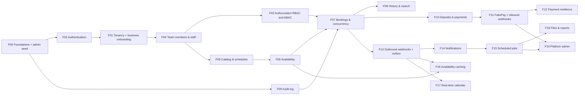

# SlotWise — Delivery Roadmap

Features are specified in [`docs/features/`](./features/); the product context is in [`docs/product/overview.md`](./product/overview.md).

The order follows dependencies: you can't search availability without schedules, can't take deposits without bookings, and can't send reminders without confirmed bookings. Each phase ends with a **demoable milestone** and leaves `main` releasable.

Durations assume one developer working part-time on the PoC; adjust to your calendar.

## Dependency graph

## Phase 0 — Foundations (week 1)

| Feature                                       | Deliverables                                                                                                                                                        |
| --------------------------------------------- | ------------------------------------------------------------------------------------------------------------------------------------------------------------------- |
| [F00](./features/F00-platform-foundations.md) | DB in `/ready`, error envelope, `RequestContext`, time & money utils, rename DBs to `slotwise-*`, seed script that creates **only the platform admin**, CI pipeline |

**Milestone:** clean clone → `docker compose up -d && npm run db:migrate && npm run db:seed && npm test` is green in CI; the seed leaves exactly one user (the platform admin), who can log in.

## Phase 1 — Core booking (weeks 2–5)

| Order | Feature                                                                  | Modules   | Key learning                                                                                                                                                          |
| ----- | ------------------------------------------------------------------------ | --------- | --------------------------------------------------------------------------------------------------------------------------------------------------------------------- |
| 1     | [F02 Authentication](./features/F02-authentication.md)                   | —         | `@nestjs/authentication`: password login, account-setup links, customer magic link; v2: customer Google/Microsoft sign-in (OIDC)                                      |
| 2     | [F01 Tenancy + onboarding](./features/F01-tenancy.md)                    | 1.10      | `tenant_id` everywhere + PostgreSQL RLS; platform admin creates business + Owner                                                                                      |
| 3     | [F04 Team members & staff](./features/F04-staff-and-membership.md)       | 1.10      | Owner adds Manager / Receptionist / Staff, single-owner index                                                                                                         |
| 4     | [F03 Authorization](./features/F03-authorization.md)                     | 1.10      | `@nestjs/authorization`: RBAC endpoints (`@Roles`, role alone decides) and ABAC endpoints (`@Policy`, ownership/status/time/role rank), query scoping, PII projection |
| 5     | [F09 Audit log](./features/F09-audit-log.md) (table + `AuditService`)    | 1.13      | Same-transaction, append-only audit                                                                                                                                   |
| 6     | [F05 Catalog & schedules](./features/F05-catalog-and-schedules.md)       | 1.12      | UTC-only storage, recurring hours across UTC midnight, paise                                                                                                          |
| 7     | [F06 Availability](./features/F06-availability-search.md)                | 1.6, 1.12 | Range/multirange SQL, GiST indexes, `EXPLAIN`                                                                                                                         |
| 8     | [F07 Bookings & concurrency](./features/F07-bookings-and-concurrency.md) | 1.8       | Exclusion constraint vs `FOR UPDATE`, holds, optimistic locking                                                                                                       |

**Milestone (demo):** starting from an empty database with only the seeded platform admin: the admin creates "Glow Salon" and its Owner; the Owner sets a password, adds a Manager, a Receptionist and a Staff member (each sets their own password), and sets up services and hours. Then a customer opens `/public/glow-salon`, sees correct slots in their local time, books (deposit = 0) and the slot disappears. A load test of 50 parallel bookings on one slot yields exactly one success. Staff sees only their own bookings; tenant B (created the same way) sees nothing of tenant A.

## Phase 2 — Querying & audit (week 6)

| Feature                                                                                | Modules | Key learning                                     |
| -------------------------------------------------------------------------------------- | ------- | ------------------------------------------------ |
| [F08 History & customer search](./features/F08-booking-history-and-customer-search.md) | 1.11    | Keyset pagination, `pg_trgm`, E.164 phone search |
| [F09 Audit log](./features/F09-audit-log.md) (API + booking timeline)                  | 1.13    | Diffs, actor context, retention                  |

**Milestone:** receptionist searches "98765 43210", opens the customer, pages through 2 years of history; the booking timeline shows who moved it and from when. `docs/perf/querying.md` compares OFFSET vs keyset.

## Phase 3 — Payments & webhooks (weeks 7–9)

| Order | Feature                                                                                   | Modules   | Key learning                                                  |
| ----- | ----------------------------------------------------------------------------------------- | --------- | ------------------------------------------------------------- |
| 1     | [F13 Outbound webhooks + outbox](./features/F13-outbound-webhooks.md)                     | 2.15      | `@nestjs/outbox`: the event pipeline the rest of the app uses |
| 2     | [F10 Deposits & payments](./features/F10-deposits-and-payments.md)                        | 2.5, 1.12 | `@nestjs/idempotency`, three layers of "charge once"          |
| 3     | [F11 FakePay + inbound webhooks](./features/F11-payment-provider-and-inbound-webhooks.md) | 2.15      | HMAC verify, dedupe, async processing, out-of-order events    |
| 4     | [F12 Payment resilience](./features/F12-payment-resilience.md)                            | 2.4       | `@nestjs/resilience`: timeout, retry, circuit breaker         |

Outbox comes first in this phase because payments, notifications, caching and real-time all publish through it.

**Milestone (demo):** double-click "Pay deposit" → one charge. FakePay sends the webhook twice and out of order → booking confirmed once. Set `FAKEPAY_DOWN=true` → slot stays held, breaker opens, payment completes when FakePay returns. A sample receiver gets signed `booking.confirmed` webhooks.

## Phase 4 — Async & live experience (weeks 10–12)

| Order | Feature                                                            | Modules  | Key learning                                                       |
| ----- | ------------------------------------------------------------------ | -------- | ------------------------------------------------------------------ |
| 1     | [F14 Notifications](./features/F14-notifications.md)               | 2.13     | Email catalogue, preferences, one-click unsubscribe, in-app alerts |
| 2     | [F15 Scheduled jobs](./features/F15-scheduled-jobs.md)             | 2.8, 2.9 | Delayed jobs, daily crons, `@nestjs/locks`, idempotent processors  |
| 3     | [F16 Availability caching](./features/F16-availability-caching.md) | 1.16     | Versioned keys, event-driven invalidation, stampede protection     |
| 4     | [F17 Real-time calendar](./features/F17-realtime-calendar.md)      | 2.14     | SSE + Redis pub/sub fan-out, policy-filtered events, replay        |

**Milestone (demo):** customer books online → receptionist calendar updates live in < 1 s, customer gets a confirmation email with `.ics`, reminders are scheduled 24 h / 1 h before (verified with fake timers), staff get a 07:00 IST digest. Public availability is served from Redis at p95 < 10 ms and never shows a just-booked slot.

## Phase 5 — Files, operations & hardening (weeks 13–14)

| Feature / task                                             | Modules | Key learning                                                                                                                                         |
| ---------------------------------------------------------- | ------- | ---------------------------------------------------------------------------------------------------------------------------------------------------- |
| [F18 Files & reports](./features/F18-files-and-reports.md) | 2.12    | Presigned uploads, MinIO, streamed CSV report                                                                                                        |
| [F19 Platform admin](./features/F19-platform-admin.md)     | 1.10    | Cross-tenant ops without PII, break-glass access                                                                                                     |
| Hardening                                                  | —       | Security review (`/security-review`), load tests (k6) for availability + booking, `docs/perf/*` results, OpenAPI polish, Observe dashboards, runbook |

**Milestone (final demo):** full journey from the platform admin creating a new business to monthly revenue report, plus the platform admin retrying a failed job and reading webhook logs with customer data masked.

## Definition of done (every feature)

- Prisma migration committed (custom SQL for constraints/RLS/indexes where Prisma can't express them); `npm run db:migrate:status` clean.
- Controller → service → repository layering; repositories take `tenantId` and `select` only returned fields.
- Zod schemas in `<feature>.schemas.ts`; endpoints documented in Swagger with every response status.
- Authorization covered by policies; audit entries for every booking-affecting mutation.
- Unit tests beside the code; e2e for the acceptance criteria in the spec, including **at least one cross-tenant isolation test**.
- New env vars added to `envSchema`, `.env.example` and `docs/architecture.md`.
- `docs/architecture.md` updated when a module, guard, queue or shared integration is added.
- `npm run lint`, typecheck, `npm test`, `npm run test:e2e` green in CI.

## Suggested branch / PR plan

One branch and PR per feature (`feat/f07-bookings`), large features split into PRs by layer — e.g. F07: (1) schema + exclusion constraint + concurrency test, (2) create/hold, (3) reschedule/cancel, (4) staff-side endpoints.

## Risks to watch

| Risk                                                                | Mitigation                                                                                                                                         |
| ------------------------------------------------------------------- | -------------------------------------------------------------------------------------------------------------------------------------------------- |
| Prisma can't model exclusion constraints, RLS, partial/GiST indexes | `npm run db:migrate:create`, then hand-edit the SQL before applying; document each in the migration.                                               |
| RLS + Prisma connection pooling leaks tenant context                | Only `set_config(..., true)` (transaction-local) inside `$transaction`; e2e test that a fresh query sees no rows.                                  |
| Local-time bugs                                                     | DB and API are UTC only; the frontend owns conversion. Backend tests cover working hours crossing UTC midnight and 18:30Z-bounded holidays/months. |
| Scope creep in Phase 4–5                                            | F17 WebSockets, ClamAV scan, PDF reports and MFA are marked stretch.                                                                               |
